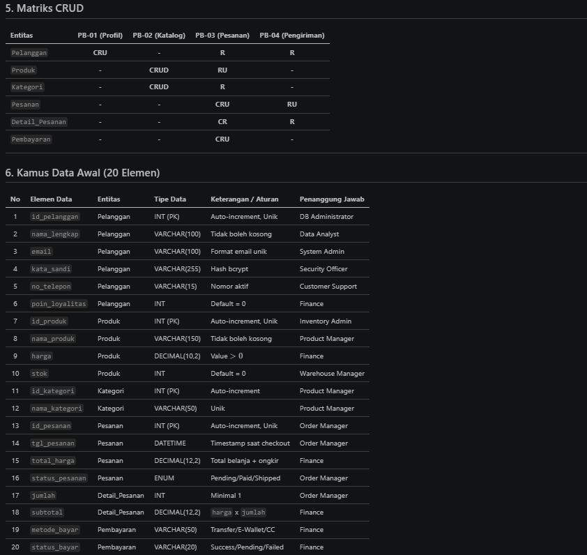

# Laporan Praktikum Basis Data - Pertemuan 02
**Nama:** M Ilham A Hakim  **NPM:** 25430099  **Kelas:** Basis Data  **Tanggal:** 23 Oktober 2026

---

## 1. Tujuan Praktikum
1. Memahami konsep identifikasi kebutuhan data dan analisis domain sistem informasi.
2. Mampu menentukan entitas kandidat, atribut, aturan bisnis (*business rules*), dan kebutuhan informasi pada sistem Toko Daring (`toko_099`).
3. Mampu menyusun Matriks CRUD (Create, Read, Update, Delete) dan Kamus Data awal.
4. Mampu melakukan identifikasi kebutuhan non-fungsional terkait keamanan data pribadi (PII).
5. Mampu membedah dokumen sumber transaksi menjadi entitas dan atribut basis data terstruktur.

---

## 2. Ringkasan Dasar Teori
* **Analisis Kebutuhan Data:** Proses mengidentifikasi, mengumpulkan, dan mendokumentasikan data yang dibutuhkan oleh suatu sistem agar mendukung proses bisnis secara optimal.
* **Aturan Bisnis (Business Rules):** Deklarasi formal mengenai batasan, syarat, atau kebijakan operasional yang mengatur data dan alur transaksi dalam organisasi.
* **Matriks CRUD:** Pemetaan hubungan antara proses bisnis dengan entitas data untuk memastikan seluruh entitas dibuat (*Create*), dibaca (*Read*), diperbarui (*Update*), atau dihapus (*Delete*) dengan benar tanpa entitas yang terbengkalai.
* **Kamus Data (Data Dictionary):** Repositori terpusat yang mencakup definisi teknis elemen data, seperti nama atribut, tipe data, nilai default, hingga penanggung jawab data.
* **Data Pribadi (PII - Personally Identifiable Information):** Informasi yang dapat digunakan untuk mengidentifikasi individu secara langsung atau tidak langsung yang memerlukan perlindungan akses khusus.

---

## 3. Hasil Langkah Percobaan (tanggapan layar + keterangan)

| No | Tangkapan Layar | Keterangan Langkah Percobaan |
| :---: | :---: | :--- |
| 1 | ` | Dokumentasi Kebutuhan Data proyek Toko Daring (`toko_099`) yang mencakup proses bisnis, aturan bisnis, dan kamus data. |
| 2 | ` | Tampilan Matriks CRUD yang memetakan hubungan antara alur proses bisnis dengan entitas data. |

---

## 4. Jawaban Titik Analisis
1. **Mengapa identifikasi entitas dan atribut harus dilakukan sebelum pembuatan tabel SQL?**  
   *Jawaban:* Agar struktur basis data terencana secara logis dan terhindar dari redundansi data, kehilangan relasi antar entitas, serta kesalahan tipe data saat tahap implementasi fisik.
2. **Apa dampak jika terdapat entitas dalam Matriks CRUD yang tidak pernah di-create (C)?**  
   *Jawaban:* Entitas tersebut menjadi *dead entity* (entitas mati) karena datanya tidak akan pernah bisa diinput ke dalam sistem, sehingga proses bisnis yang membutuhkan data tersebut akan gagal/bermasalah.
3. **Mengapa data pribadi seperti kata sandi dan alamat pelanggan memerlukan penanganan khusus dalam kebutuhan non-fungsional?**  
   *Jawaban:* Untuk mematuhi regulasi perlindungan data pribadi (PDP) serta mencegah kebocoran data sensitif dari akses pengguna yang tidak berwenang atau serangan peretasan.

---

## 5. Hasil Latihan dan Modifikasi

### E.1. Modifikasi Poin Loyalitas (Toko Daring)
* **Elemen Data Tambahan:** `poin_loyalitas` (Pelanggan), `poin_diperoleh` (Pesanan), `poin_ditukar` (Pesanan), `potongan_poin` (Pesanan).
* **Aturan Bisnis Baru:**
  * **AB-07:** Setiap kelipatan belanja Rp10.000 pada transaksi pesanan yang telah selesai (*Completed*), pelanggan memperoleh 1 poin loyalitas.
  * **AB-08:** Poin loyalitas bernilai Rp100 per poin (50 poin dapat digunakan untuk potongan belanja sebesar Rp5.000).
  * **AB-09:** Penukaran poin hanya dapat dilakukan jika saldo poin pelanggan minimal 50 poin dan potongan tidak melebihi total tagihan belanja.
* **Kebutuhan Informasi Tambahan:**
  * **KI-06:** Laporan riwayat perolehan dan penukaran poin loyalitas per pelanggan.
  * **KI-07:** Daftar pelanggan dengan poin loyalitas tertinggi yang memenuhi syarat penukaran diskon.
* **Pembaruan Matriks CRUD:**
  * Entitas `Pelanggan`: Diperbarui (**Update**) oleh Proses Pemrosesan Pesanan saat poin bertambah/berkurang.
  * Entitas `Pesanan`: Dibuat (**Create**) mencakup data `poin_diperoleh` dan `poin_ditukar`.

### E.2. Perbaikan Pernyataan Kebutuhan Kabur

| Pernyataan Kabur | Perbaikan Kebutuhan Terukur & Dapat Diuji |
| :--- | :--- |
| **(a) "data anggota harus aman"** | **"Data kata sandi pelanggan wajib dienkripsi menggunakan algoritma bcrypt (cost factor $\ge 10$) dan seluruh transaksi data pribadi/pembayaran wajib menggunakan protokol HTTPS (TLS 1.3)."** |
| **(b) "sistem harus cepat mencari barang"** | **"Pencarian produk berdasarkan nama atau kategori harus menampilkan hasil dalam waktu kurang dari 1,5 detik pada kondisi beban 500 pengguna aktif bersamaan."** |
| **(c) "laporan stok harus akurat"** | **"Sistem wajib mengurangi stok produk secara *real-time* saat pesanan terbuat dan membatalkan pesanan otomatis jika stok produk $\le 0$, serta menghasilkan laporan rekonsiliasi stok dengan selisih 0% antara data sistem dan gudang."** |

---

## 6. Tugas Mandiri: Milestone Proyek 02
Dokumen lengkap kebutuhan data proyek Toko Daring (`toko_099`) disajikan di bawah ini dan juga telah disimpan secara terpisah pada berkas **`laporan/p02_kebutuhan_data_25430099.md`**.

<b>Klik untuk membuka Dokumen Kebutuhan Data (p02_kebutuhan_data_25430099.md)</b>

### 1. Proses Bisnis Utama
1. **PB-01 (Pendaftaran & Profil Pelanggan):** Pengelolaan akun pelanggan daring.
2. **PB-02 (Manajemen Katalog Produk):** Pengelolaan data produk, stok, dan harga oleh admin.
3. **PB-03 (Pemrosesan Pesanan & Transaksi):** Alur pemesanan produk oleh pelanggan hingga konfirmasi pembayaran.
4. **PB-04 (Pengiriman & Pelacakan):** Pengelolaan resi dan status pengiriman barang via kurir.

### 2. Entitas Kandidat
1. `Pelanggan` (Entitas Utama)
2. `Produk` (Entitas Utama)
3. `Kategori` (Entitas Pendukung)
4. `Pesanan` (Entitas Transaksi Utama)
5. `Detail_Pesanan` (Entitas Transaksi Detail)
6. `Pembayaran` (Entitas Transaksi Finansial)

### 3. Aturan Bisnis (Business Rules)
* **AB-01:** Setiap pelanggan wajib mendaftarkan alamat email unik yang valid.
* **AB-02:** Setiap produk harus terikat pada minimal satu kategori produk.
* **AB-03:** Harga produk tidak boleh bernilai negatif ($> 0$).
* **AB-04:** Stok produk berkurang otomatis saat pesanan dikonfirmasi.
* **AB-05:** Satu pesanan dapat berisi lebih dari satu jenis produk (`Detail_Pesanan`).
* **AB-06:** Pembayaran dianggap sah jika jumlah bayar sama dengan total tagihan pesanan.
* **AB-07:** Setiap kelipatan belanja Rp10.000 bernilai 1 poin loyalitas bagi pelanggan.
* **AB-08:** Status pesanan secara berurutan adalah: *Pending*, *Paid*, *Shipped*, *Completed*, atau *Cancelled*.

### 4. Kebutuhan Informasi (Information Requirements)
* **KI-01:** Laporan rekapitulasi penjualan bulanan per kategori produk.
* **KI-02:** Daftar produk dengan jumlah stok di bawah batas minimum (peringatan stok tipis).
* **KI-03:** Riwayat transaksi dan status pengiriman pesanan per pelanggan.
* **KI-04:** Laporan omset bersih dan metode pembayaran terpopuler.
* **KI-05:** Daftar 10 pelanggan paling aktif berdasarkan total belanja dan poin loyalitas.

### 5. Matriks CRUD

| Entitas | PB-01 (Profil) | PB-02 (Katalog) | PB-03 (Pesanan) | PB-04 (Pengiriman) |
| :--- | :---: | :---: | :---: | :---: |
| `Pelanggan` | **CRU** | - | **R** | **R** |
| `Produk` | - | **CRUD** | **RU** | - |
| `Kategori` | - | **CRUD** | **R** | - |
| `Pesanan` | - | - | **CRU** | **RU** |
| `Detail_Pesanan` | - | - | **CR** | **R** |
| `Pembayaran` | - | - | **CRU** | - |

### 6. Kamus Data Awal (20 Elemen)

| No | Elemen Data | Entitas | Tipe Data | Keterangan / Aturan | Penanggung Jawab |
| :---: | :--- | :--- | :--- | :--- | :--- |
| 1 | `id_pelanggan` | Pelanggan | INT (PK) | Auto-increment, Unik | DB Administrator |
| 2 | `nama_lengkap` | Pelanggan | VARCHAR(100) | Tidak boleh kosong | Data Analyst |
| 3 | `email` | Pelanggan | VARCHAR(100) | Format email unik | System Admin |
| 4 | `kata_sandi` | Pelanggan | VARCHAR(255) | Hash bcrypt | Security Officer |
| 5 | `no_telepon` | Pelanggan | VARCHAR(15) | Nomor aktif | Customer Support |
| 6 | `poin_loyalitas` | Pelanggan | INT | Default = 0 | Finance |
| 7 | `id_produk` | Produk | INT (PK) | Auto-increment, Unik | Inventory Admin |
| 8 | `nama_produk` | Produk | VARCHAR(150) | Tidak boleh kosong | Product Manager |
| 9 | `harga` | Produk | DECIMAL(10,2) | Value $> 0$ | Finance |
| 10 | `stok` | Produk | INT | Default = 0 | Warehouse Manager |
| 11 | `id_kategori` | Kategori | INT (PK) | Auto-increment | Product Manager |
| 12 | `nama_kategori` | Kategori | VARCHAR(50) | Unik | Product Manager |
| 13 | `id_pesanan` | Pesanan | INT (PK) | Auto-increment, Unik | Order Manager |
| 14 | `tgl_pesanan` | Pesanan | DATETIME | Timestamp saat checkout | Order Manager |
| 15 | `total_harga` | Pesanan | DECIMAL(12,2) | Total belanja + ongkir | Finance |
| 16 | `status_pesanan` | Pesanan | ENUM | Pending/Paid/Shipped | Order Manager |
| 17 | `jumlah` | Detail_Pesanan | INT | Minimal 1 | Order Manager |
| 18 | `subtotal` | Detail_Pesanan | DECIMAL(12,2) | `harga` x `jumlah` | Finance |
| 19 | `metode_bayar` | Pembayaran | VARCHAR(50) | Transfer/E-Wallet/CC | Finance |
| 20 | `status_bayar` | Pembayaran | VARCHAR(20) | Success/Pending/Failed | Finance |

### 7. Kebutuhan Non-Fungsional & Keamanan Data Pribadi
1. **Identifikasi Data Pribadi (PII):** `nama_lengkap`, `email`, `kata_sandi`, `no_telepon`, `alamat_pengiriman`.
2. **Hak Akses & Otorisasi:**
   * **Pelanggan:** Melihat dan mengubah data pribadi milik sendiri.
   * **Kurir / Logistik:** Hanya membaca `nama_lengkap`, `no_telepon`, dan `alamat_pengiriman`.
   * **Admin System:** Dilarang melihat `kata_sandi` dalam bentuk teks asli (*plaintext*).

### 8. Dokumen Sumber Fiktif & Bedah Data
* **Dokumen Sumber:** Nota Penjualan Daring (Invoice `INV/20261023/099`).
* **Pembedahan Data:**
  * Header Nota (`No. Invoice`, `Tanggal`, `GRAND TOTAL`) $\rightarrow$ Entitas **`Pesanan`**.
  * Data Pelanggan (`Pelanggan`, `Alamat`) $\rightarrow$ Entitas **`Pelanggan`**.
  * Tabel Baris Produk (`Nama Produk`, `Harga Satuan`, `Qty`, `Subtotal`) $\rightarrow$ Entitas **`Detail_Pesanan`** & **`Produk`**.
  * Ringkasan Finansial (`Diskon Poin`, `Poin Diperoleh`) $\rightarrow$ Entitas **`Pesanan`** & **`Pelanggan`**.

---

## 7. Pembahasan dan Kendala
* **Pembahasan:** Praktikum Modul 2 berhasil memetakan proses bisnis Toko Daring ke dalam 6 entitas kandidat lengkap dengan matriks CRUD dan 20 kamus data awal. Sistem poin loyalitas juga berhasil terintegrasi dengan penyesuaian aturan bisnis.
* **Kendala:** Penentuan batasan hak akses data pribadi (PII) memerlukan ketelitian agar tim logistik/kurir hanya menerima data alamat tanpa bisa mengakses kredensial atau riwayat transaksi lainnya.

---

## 8. Kesimpulan
1. Pemodelan kebutuhan data yang terstruktur sebelum perancangan basis data fisik dapat mencegah kesalahan relasi dan kerancuan atribut.
2. Matriks CRUD memastikan semua entitas terlibat secara aktif dalam minimal satu proses bisnis.
3. Penerapan keamanan PII dan pembuatan aturan bisnis yang terukur menjamin sistem Toko Daring dapat diuji ketahanannya secara teknis.

---

## 9. Pernyataan Penggunaan AI
Laporan ini disusun dengan bantuan AI (Gemini) sebagai asisten diskusi untuk membantu penyusunan draf struktur Markdown, pemetaan Matriks CRUD, dan formulasi kata-kata kebutuhan non-fungsional. Seluruh variabel seperti NPM (`25430099`), nama pengembang (`M Ilham A Hakim`), studi kasus toko daring (`toko_099`), dan substansi analisis telah diperiksa dan disesuaikan secara mandiri.

---

## 10. Bukti Git
* **Tautan Repositori:** https://github.com/ilhamvivometro-star/basisdata-2301010099
* **Hash Commit Terakhir:** `9b69c71`

---

## Checklist
- [x] Struktur folder `laporan/` dan nama file sesuai instruksi (`p02_laporan_25430099.md`).
- [x] Mengisi identitas Nama (M Ilham A Hakim), NPM (25430099), Kelas, dan Tanggal secara lengkap.
- [x] Latihan dan Modifikasi E.1 (Poin Loyalitas Toko Daring) diselesaikan.
- [x] Latihan dan Modifikasi E.2 (Perbaikan Kebutuhan Kabur) diselesaikan.
- [x] Dokumen Kebutuhan Data F (Milestone Proyek 2) diselesaikan minimal 20 elemen kamus data.
- [x] Menyajikan Matriks CRUD dan Identifikasi Data Pribadi (PII).
- [x] Menyiapkan bukti commit dan tautan repositori GitHub.