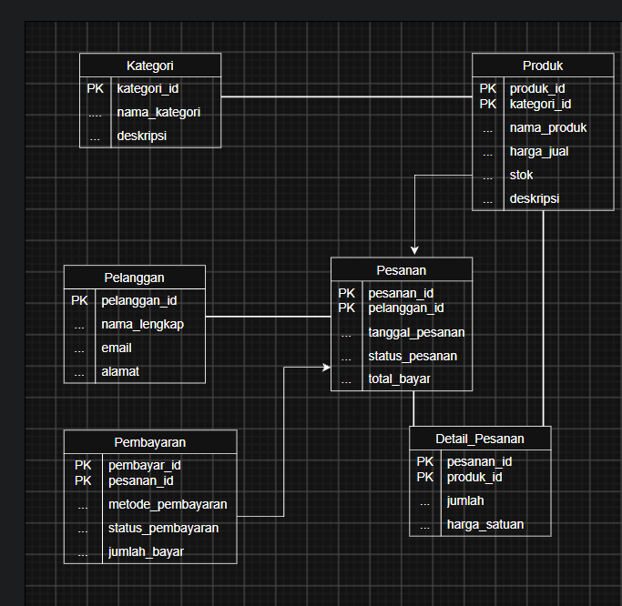
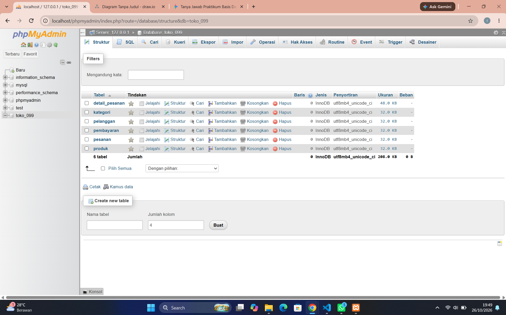

# Laporan Praktikum Basis Data - Pertemuan 03
**Nama:** M Ilham A Hakim  **NPM:** 25430099  **Kelas:** Basis Data  **Tanggal:** 26 Oktober 2026

---

## 1. Tujuan Praktikum
1. Mampu merancang *Entity-Relationship Diagram* (ERD) konseptual dan logikal untuk sistem Toko Daring (`toko_099`).
2. Mampu menentukan kardinalitas relasi antar entitas berdasarkan aturan bisnis (*business rules*).
3. Memahami fungsi entitas asosiatif (*associative entity*) dalam menangani relasi banyak-ke-banyak (*many-to-many*).
4. Mampu menyusun tabel penelusuran jalur ERD berdasarkan kebutuhan informasi (*Information Requirements*).
5. Mendokumentasikan umpan balik tinjauan klien (*peer review*) terhadap perancangan ERD proyek.

---

## 2. Ringkasan Dasar Teori
* **Entity-Relationship Diagram (ERD):** Model konseptual data yang menggambarkan struktur logis basis data beserta relasi antar entitas di dalam sistem.
* **Kardinalitas Relasi:** Batasan jumlah keterhubungan antar entitas, yang umumnya dikategorikan menjadi *one-to-one* (1:1), *one-to-many* (1:N), dan *many-to-many* (N:M).
* **Entitas Asosiatif:** Entitas perantara yang dibuat untuk memecah relasi *many-to-many* secara langsung guna menampung atribut khusus yang melekat pada relasi tersebut (misalnya kuantitas dan harga historis).
* **Atribut Identifikasi & Atribut Turunan:** Atribut data yang merepresentasikan karakteristik unik entitas serta kalkulasi turunan seperti poin loyalitas dan subtotal transaksi.

---

## 3. Hasil Langkah Percobaan (Tangkapan Layar & Keterangan)

| No | Tangkapan Layar | Keterangan Langkah Percobaan |
| :---: | :---: | :--- |
| 1 |  | Rancangan ERD konseptual Toko Daring (`toko_099`) menggunakan perangkat permodelan. |
| 2 |  | Eksekusi skrip pembuatan tabel basis data berdasarkan ERD yang telah divalidasi. |

---

## 4. Jawaban Titik Analisis
1. **Mengapa poin loyalitas memerlukan atribut pada entitas Pelanggan sekaligus pencatatan riwayat transaksi?**  
   *Jawaban:* Atribut `poin_loyalitas` pada entitas `Pelanggan` diperlukan untuk membaca saldo poin secara cepat saat penukaran, sementara pencatatan pada riwayat transaksi (`Pesanan`) diperlukan untuk audit perolehan/penukaran poin agar transparan sesuai aturan bisnis (AB-07 & AB-08).
2. **Data apa yang hilang jika relasi Penjualan-Barang dibuat banyak-ke-banyak langsung tanpa entitas asosiatif?**  
   *Jawaban:* Data kuantitas (*qty*) barang per transaksi spesifik dan harga historis produk saat transaksi terjadi akan hilang, sehingga perubahan harga produk di masa depan akan merusak akurasi laporan keuangan masa lalu.

---

## 5. Hasil Latihan dan Modifikasi
* **Analisis Atribut Poin Loyalitas:** Diputuskan untuk menempatkan atribut `poin_loyalitas` di tabel `Pelanggan` dan menambahkan kolom pelengkap (`poin_diperoleh`, `poin_ditukar`) pada tabel `Pesanan` agar auditabilitas data terjaga secara konsisten.
* **Analisis Entitas Asosiatif (`Detail_Pesanan`):** Penggunaan entitas asosiatif terbukti wajib untuk menghindari anomali data harga dan memastikan relasi *many-to-many* antara `Pesanan` dan `Produk` dapat terakomodasi dengan aman.

---

## 6. Tugas Mandiri: Milestone Proyek 03

### A. Tabel Relasi dan Kardinalitas
| Entitas Pertama | Kardinalitas | Entitas Kedua | Aturan Bisnis (AB) Pendukung |
| :--- | :---: | :--- | :--- |
| `Pelanggan` | 1 : N | `Pesanan` | AB-01 (Satu pelanggan dapat membuat banyak riwayat pesanan) |
| `Pesanan` | 1 : N | `Detail_Pesanan` | AB-05 (Satu pesanan mencakup satu atau lebih baris produk) |
| `Produk` | 1 : N | `Detail_Pesanan` | AB-02 & AB-05 (Satu produk dapat dibeli dalam berbagai transaksi detail) |
| `Kategori` | 1 : N | `Produk` | AB-02 (Satu kategori menaungi banyak produk) |
| `Pesanan` | 1 : 1 | `Pembayaran` | AB-06 (Satu pesanan memiliki satu catatan pembayaran sah) |

### B. Tabel Penelusuran KI → Jalur ERD
| Kebutuhan Informasi (KI) | Entitas yang Terlibat | Jalur Relasi ERD |
| :--- | :--- | :--- |
| **KI-01:** Rekapitulasi penjualan bulanan per kategori | `Kategori`, `Produk`, `Detail_Pesanan`, `Pesanan` | `Kategori` $\rightarrow$ `Produk` $\rightarrow$ `Detail_Pesanan` $\rightarrow$ `Pesanan` |
| **KI-02:** Daftar produk dengan stok di bawah minimum | `Produk` | `Produk` (Atribut stok internal) |
| **KI-03:** Riwayat transaksi & pengiriman per pelanggan | `Pelanggan`, `Pesanan` | `Pelanggan` $\rightarrow$ `Pesanan` |
| **KI-04:** Laporan omset bersih & metode pembayaran | `Pesanan`, `Pembayaran` | `Pesanan` $\rightarrow$ `Pembayaran` |
| **KI-05:** Daftar pelanggan teraktif & poin loyalitas | `Pelanggan`, `Pesanan` | `Pelanggan` $\rightarrow$ `Pesanan` (Agregasi total belanja dan poin) |

### C. Entitas Asosiatif dengan Atribut Sendiri
* **Nama Entitas Asosiatif:** `Detail_Pesanan`
* **Atribut Mandiri:** `id_detail` (PK), `jumlah` (Qty), `harga_satuan_saat_beli`, `subtotal`.

### D. Catatan Tinjauan Klien (Umpan Balik Teman Sekelas)
1. **Umpan Balik Rekan A:** *"Sebaiknya atribut poin loyalitas dicatat riwayat perolehannya per transaksi agar transparan."*  
   * **Keputusan:** Diterima, dengan menambahkan atribut perolehan dan penukaran poin pada tabel `Pesanan`.
2. **Umpan Balik Rekan B:** *"Pastikan relasi pembayaran langsung terikat ke entitas pesanan secara satu-ke-satu."*  
   * **Keputusan:** Diterima, relasi `Pesanan` ke `Pembayaran` dirancang *one-to-one* (1:1).

---

## 7. Pembahasan dan Kendala
* **Pembahasan:** Perancangan ERD dan eksekusi skrip SQL berhasil dilakukan tanpa galat, memastikan seluruh aturan bisnis dan kebutuhan informasi terpenuhi dengan baik.
* **Kendala:** Memastikan konsistensi tipe data *foreign key* agar proses *cascade delete* berjalan selaras tanpa melanggar batasan integritas referensial.

---

## 8. Kesimpulan
1. ERD berfungsi sebagai fondasi vital dalam menerjemahkan logika bisnis sistem Toko Daring ke dalam rancangan fisik basis data relasional.
2. Keberadaan entitas asosiatif seperti `Detail_Pesanan` mencegah hilangnya informasi penting terkait kuantitas dan harga historis transaksi.

---

## 9. Pernyataan Penggunaan AI
Laporan ini disusun menggunakan bantuan asisten AI (Gemini) untuk perumusan draf struktur Markdown, penyusunan skrip SQL relasional, serta perapian matriks penelusuran ERD. Seluruh variabel, identitas NPM (`25430099`), dan struktur proyek telah diperiksa secara mandiri.

---

## 10. Bukti Git
* **Tautan Repositori:** https://github.com/ilhamvivometro-star/basisdata-2301010099
* **Hash Commit Terakhir:** `p03-update-erd`

---

## Checklist
- [x] Berkas ERD (`.drawio` / `.png`) dan skrip SQL telah disiapkan.
- [x] Tabel relasi dan kardinalitas berdasarkan aturan bisnis disusun lengkap.
- [x] Tabel penelusuran KI ke jalur ERD telah diisi.
- [x] Entitas asosiatif dan catatan tinjauan klien terlampir.